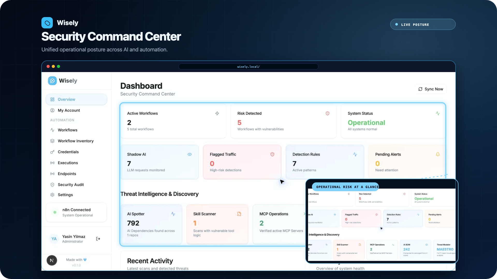
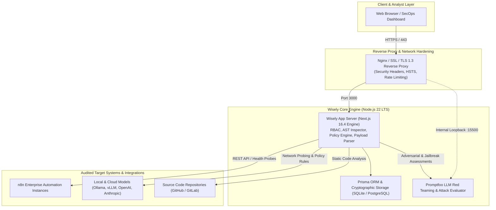
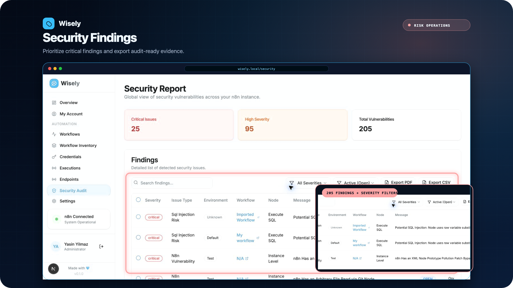
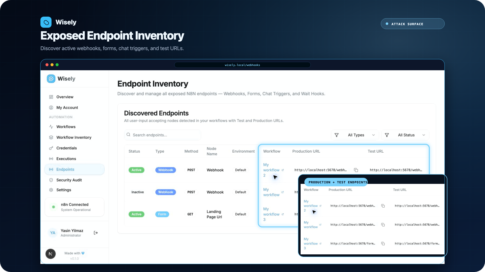
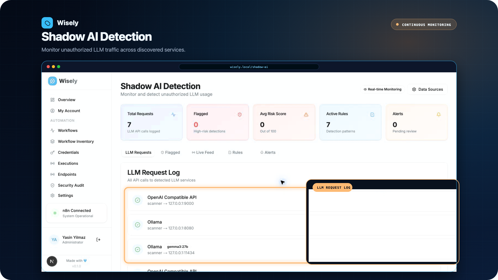
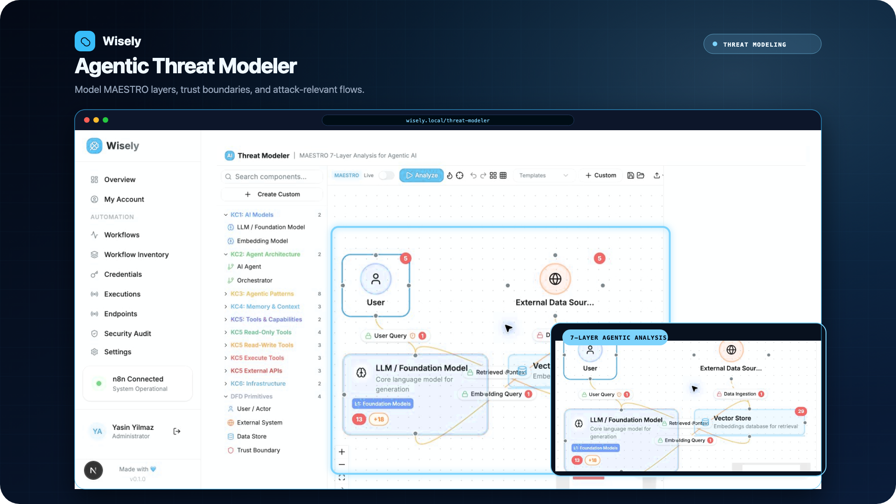
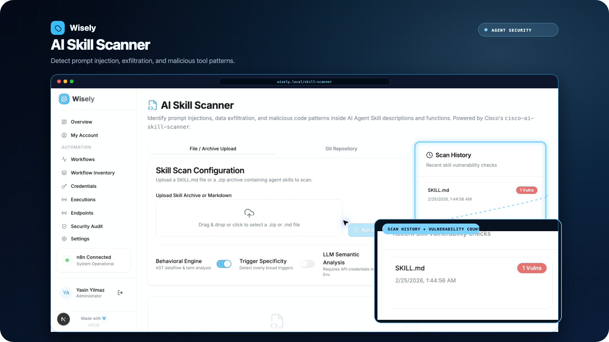

<div align="center">

# Wisely

### Enterprise n8n Workflow, AI/LLM Security & Threat Management Platform

<p align="center">
  <b>Audit your no-code/low-code automations, govern internal Shadow AI traffic, detect vulnerabilities, and subject your AI agents to automated continuous Red Teaming.</b>
</p>

[](https://github.com/move-seventy-eight/wisely)
[](https://nextjs.org/)
[](https://react.dev/)
[](https://www.typescriptlang.org/)
[](https://tailwindcss.com/)
[](https://www.prisma.io/)
[](https://www.promptfoo.dev/)
[](LICENSE)

---

</div>

## Executive Summary

In modern enterprise environments, mission-critical business processes are rapidly migrating to no-code/low-code workflow orchestration platforms such as **n8n** and **Large Language Models (LLMs)**. However, this architectural evolution introduces critical blind spots: unauthenticated and exposed webhook endpoints, unvetted private AI deployments (**Shadow AI**), credential leakage, and prompt injection attack vectors that traditional Web Application Firewalls (WAF) and legacy static analysis tools cannot address.

**Wisely** is a **production-grade** security and threat management platform engineered for DevSecOps, AppSec, and LLMOps teams. It delivers 360-degree visibility, automated static AST code auditing, real-time traffic inspection, and integrated automated AI red teaming across your entire automation and AI ecosystem.

<div align="center">
  
</div>

---

## Production Architecture



---

## Core Security Modules

### 1. n8n Workflow Security Audit
* **Abstract Syntax Tree (AST) Code Inspection:** Evaluates individual n8n nodes, parameter fields, and inline JavaScript/Python code blocks using static analysis.
* **Comprehensive Vulnerability Detection:**
  * **SQL Injection (SQLi):** Non-parameterized, dynamically concatenated SQL query statements.
  * **Command Injection:** Unsanitized user inputs passed directly into shell-executing nodes (`Execute Command`).
  * **Server-Side Request Forgery (SSRF):** Dynamic HTTP request endpoints targeting cloud metadata services (`169.254.169.254`) or internal loopback subnets.
  * **Path Traversal & Arbitrary File Access:** Unrestricted file system reads and writes.
  * **Cross-Site Scripting (XSS) & Template Injection:** Unsanitized expressions evaluated in browser contexts.
  * **Hardcoded Credentials:** Static API keys, bearer tokens, AWS credentials, and passwords committed directly in workflow configurations.
* **Weighted Risk Scoring & Actionable Remediation:** Generates a 0–100 risk score with tailored, copy-paste code remediation snippets.

> [!TIP]
> **Ready-to-Test Vulnerable Workflows:** To verify Wisely's AST detection engine in an isolated sandbox, import the 7 sample workflows provided in [`examples/vulnerable-workflows/`](examples/vulnerable-workflows/) (Command Injection, SSRF, SQLi, Hardcoded Secrets, Path Traversal, XSS, and Unauthenticated Webhook) into your test n8n instance.

<div align="center">
  
</div>

---

### 2. Dynamic Endpoint & Webhook Request Generator
* **Automated Discovery:** Automatically catalogs all **Webhook**, **Form Trigger**, **Chat Trigger**, and **Wait Node** entry points across all workflows.
* **Connection Graph Tracing:** Traces the workflow directed acyclic graph (DAG) downstream from the trigger to identify exact parameter schemas (`$json.body.param`, `$json.query.param`, `$json.headers.param`) expected by subsequent nodes.
* **Multi-Format Security Testing Outputs:**
  * **Raw HTTP Request (RFC 9112):** Standard RFC-compliant HTTP payloads ready for Burp Suite, OWASP ZAP, or raw socket testing.
  * **cURL Command:** Pre-formatted command line syntax ready for terminal execution.
  * **JSON Body:** Clean, structured payload schema for automated testing pipelines.
  * **Promptfoo, Promptmap & PyRIT:** Exportable configuration templates for automated adversarial red teaming.

<div align="center">
  
</div>

---

### 3. Shadow AI & LLM Traffic Governance
* **Network-Level Model Discovery:** Discovers unapproved, rogue LLM instances (Ollama, vLLM, LocalAI, LM Studio) running across internal subnets via port sweeping and service fingerprinting.
* **Rule Engine & Security Policies:**
  * **Personally Identifiable Information (PII) Redaction:** Real-time regex and checksum identification of National IDs, SSNs, credit cards, telephone numbers, and email addresses.
  * **Sensitive Credential Interception:** Pattern matching against OpenAI, GitHub, AWS, and GCP API keys in outbound prompts.
  * **Prompt Injection & Jailbreak Heuristics:** Intercepts adversarial prompt tokens attempting to override system prompts (`Ignore previous instructions`, `DAN mode`).
  * **Model Compliance & Leaderboard Matching:** Maps discovered models against the Cisco AI Security Leaderboard to assess inherent model risk.

<div align="center">
  
</div>

---

### 4. Automated AI Red Teaming & Threat Modeling
* **Promptfoo Engine Integration:** Execute single-click adversarial evaluations against webhook endpoints and LLM pipelines directly from the dashboard.
* **STRIDE Threat Modeling:** Automatically calculates the STRIDE threat profile for AI workflows and visualizes active **Attack Paths** leading to vulnerable components.
* **Adversarial Attack Vectors:** Tests for prompt injection, jailbreaking, hallucination susceptibility, sensitive data exfiltration, and RAG poisoning.

<div align="center">
  
</div>

---

### 5. Enterprise Discovery Suite

| Module | Core Functionality & Security Value |
| :--- | :--- |
| **AI Spotter** | Scans Git source repositories to identify AI model usages, embedded libraries, and vector database dependencies. |
| **Skill Scanner** | Audits AI Agent skills and tool configurations for excessive file system permissions, shell command execution, and insecure capabilities. |
| **MCP Scanner** | Discovers Model Context Protocol (MCP) servers, auditing their registered tool interfaces, prompt templates, and security boundaries. |
| **AIBOM Scanner** | Generates an **AI Bill of Materials (AIBOM)** detailing model architectures, licensing terms, and dataset compliance. |

<div align="center">
  
</div>

---

### 6. Enterprise Identity, RBAC & Authentication Hardening
* **Role-Based Access Control (RBAC):** Built-in `ADMIN`, `ANALYST`, and `VIEWER` roles enforced via route-level and action-level permission matrices.
* **Cryptographic Password Security:** Salted `scrypt` hashing with constant-time dummy verification to defeat username enumeration timing attacks.
* **Session Hardening & Sliding-Window Rate Limiting:** Sessions expire after 4 hours (12-hour hard cap) with automatic database purging and IP/email rate limiting on login attempts.
* **Initial Administrator Setup:** If no users exist in the database, Wisely securely enters initial setup mode, generating a cryptographically secure random password.

---

## Production Deployment Guide

Wisely can be deployed in two enterprise production configurations:
1. **[Option A: Docker & Docker Compose (Recommended)](#option-a-docker--docker-compose-recommended)**: Full container isolation, minimal host overhead, and turnkey orchestration.
2. **[Option B: Bare-Metal / Linux Server (Node.js + PM2 + Nginx)](#option-b-linux-server-nodejs--pm2--nginx)**: High-performance deployment on enterprise Linux distributions (Ubuntu, Debian, RHEL).

---

### Option A: Docker & Docker Compose (Recommended)

Wisely provides a hardened, multi-stage, `non-root` [Dockerfile](Dockerfile) and [docker-compose.yml](docker-compose.yml).

#### 1. Clone the Repository
```bash
git clone https://github.com/move-seventy-eight/wisely.git
cd wisely
```

#### 2. Configure Environment Variables
```bash
cp .env.example .env
```
Edit `.env` to configure your server hostname and target n8n instance:
```env
NODE_ENV="production"
PORT=3000
DATABASE_URL="file:/app/prisma/dev.db"
NEXT_PUBLIC_PROMPTFOO_URL="http://localhost:15500"
N8N_BASE_URL="http://localhost:5678"
N8N_API_KEY="your_n8n_api_key_here"
```

#### 3. Build and Launch Containers
```bash
docker compose up -d --build
```

#### 4. Verify Service Health
```bash
docker compose ps
docker compose logs -f wisely
```
Once initialized:
* **Wisely Management Dashboard:** `http://your-server-ip:3000`
* **Promptfoo Internal Service:** `http://127.0.0.1:15500` (isolated to internal network)

---

### Option B: Linux Server (Node.js + PM2 + Nginx)

For deployments on Ubuntu 22.04 / 24.04 LTS, Debian 12, or RHEL-based distributions:

#### 1. Install System Prerequisites
```bash
# Install Node.js 22 LTS
curl -fsSL https://deb.nodesource.com/setup_22.x | sudo -E bash -
sudo apt-get install -y nodejs nginx git

# Install PM2 Process Manager globally
sudo npm install -g pm2
```

#### 2. Clone Repository to Deployment Directory
```bash
sudo git clone https://github.com/move-seventy-eight/wisely.git /opt/wisely
cd /opt/wisely
```

#### 3. Install Dependencies & Configure Environment
```bash
npm ci
cp .env.example .env
nano .env
```

#### 4. Initialize Database
Initialize the database with clean schema fixtures:
```bash
npm run db:seed
```

#### 5. Build Production Artifacts
```bash
npm run build
```

#### 6. Start Services via PM2
Wisely includes a pre-configured [ecosystem.config.cjs](ecosystem.config.cjs) for PM2:
```bash
pm2 start ecosystem.config.cjs
pm2 save
pm2 startup
```

Monitor status and logs:
```bash
pm2 status
pm2 logs
```

#### 7. Nginx Reverse Proxy & SSL Configuration
Enable the production Nginx template provided in `docs/`:
```bash
sudo cp docs/nginx.conf.example /etc/nginx/sites-available/wisely.conf
sudo nano /etc/nginx/sites-available/wisely.conf
```
*Update `server_name` to your domain (e.g., `wisely.yourdomain.com`).*

Enable the site configuration and reload Nginx:
```bash
sudo ln -s /etc/nginx/sites-available/wisely.conf /etc/nginx/sites-enabled/
sudo nginx -t
sudo systemctl reload nginx
```

Obtain a free Let's Encrypt TLS certificate:
```bash
sudo apt-get install -y certbot python3-certbot-nginx
sudo certbot --nginx -d wisely.yourdomain.com
```

---

## Initial Administrator Setup

1. Open your browser and navigate to your deployed instance (e.g., `https://wisely.yourdomain.com` or `http://localhost:3000`).
2. When the user table is empty, Wisely automatically displays the **"Initial Administrator Setup"** screen.
3. Enter your administrator Name and Email Address.
4. The system securely generates a random, high-entropy initial password on screen.
5. Store the password in your enterprise password manager and proceed to log in to the dashboard.

---

## Connecting Your n8n Instance

1. In your n8n management console, navigate to **Settings ➔ n8n API**.
2. Generate and copy a new API Key.
3. In Wisely, open the sidebar and select **Settings ➔ N8n Environments**:
   * **Environment Name:** `Production Cluster 01`
   * **Base URL:** `https://n8n.yourdomain.com` (or `http://localhost:5678`)
   * **API Key:** Paste your generated API key.
4. Click **"Sync Workflows"**. Wisely will discover workflows, parse connection graphs, index endpoints, and perform AST security audits within seconds.

---

## Production Security Hardening Checklist

Ensure the following criteria are validated prior to enterprise deployment:

- [x] **Port Isolation:** Port `15500` (Promptfoo) must never be exposed publicly. Bind only to `127.0.0.1` or keep behind the internal Docker bridge network.
- [x] **Enforce HTTPS:** Enforce TLS 1.2+ with HTTP Strict Transport Security (HSTS) on Nginx or cloud load balancers (AWS ALB, Cloudflare).
- [x] **Security Headers:** Verify `X-Content-Type-Options: nosniff`, `X-Frame-Options: SAMEORIGIN`, and `Referrer-Policy: strict-origin-when-cross-origin` are enforced by Nginx.
- [x] **Database Persistence:** Persist database storage via Docker volumes (`wisely-data`) and schedule routine backups.
- [x] **Non-Root Execution:** Execute all containerized workloads under unprivileged service users (`nextjs:nodejs`).
- [x] **Secret Isolation:** Never commit `.env` configuration files to version control.

---

## Environment Variables Reference

| Variable | Description | Default | Required |
| :--- | :--- | :--- | :--- |
| `NODE_ENV` | Runtime mode (`production` or `development`) | `production` | Yes |
| `PORT` | Listening port for web server | `3000` | No |
| `DATABASE_URL` | SQLite file path or PostgreSQL connection string | `file:./dev.db` | Yes |
| `NEXT_PUBLIC_PROMPTFOO_URL` | Internal Promptfoo service URL | `http://localhost:15500` | No |
| `N8N_BASE_URL` | Target n8n instance base URL | `http://localhost:5678` | No |
| `N8N_API_KEY` | n8n REST API authentication key | - | No |
| `OPENAI_API_KEY` | OpenAI integration for AI Spotter and scanning | - | No |
| `ANTHROPIC_API_KEY` | Anthropic Claude integration for audits | - | No |
| `GITHUB_TOKEN` | Personal access token for repository scanning | - | No |

---

## Available Scripts

| Command | Description |
| :--- | :--- |
| `npm run build` | Generates Prisma client and produces optimized Next.js Webpack production build. |
| `npm run start` | Launches compiled Next.js application in production mode (Port 3000). |
| `npm run start:prod` | Concurrently launches Next.js and the Promptfoo evaluation server in production. |
| `npm run dev` | Starts local Next.js development server. |
| `npm run db:seed` | Populates clean demo fixtures and resets user table for initial admin setup. |
| `npm run db:push` | Synchronizes Prisma schema directly with the database. |
| `npm run db:migrate` | Applies pending Prisma migrations in production environments. |
| `npm run lint` | Runs ESLint static analysis across the codebase. |

---

## Project Directory Structure

```text
wisely/
├── Dockerfile                 # Hardened multi-stage production container definition
├── docker-compose.yml         # Container orchestration and persistent volume mapping
├── ecosystem.config.cjs       # Linux PM2 cluster and process configuration
├── docs/                      # Documentation and enterprise deployment templates
│   ├── images/                # Dashboard screenshots and visual guides
│   ├── nginx.conf.example     # Hardened Nginx reverse proxy and SSL configuration
│   └── wisely.service.example # Linux systemd service unit template
├── examples/                  # Test fixtures and PoC security templates
│   └── vulnerable-workflows/  # 7 intentionally vulnerable n8n workflows (JSON) & guide
├── prisma/                    # Database models and migration fixtures
│   ├── dev.db                 # SQLite database
│   ├── schema.prisma          # Prisma schema definition
│   └── seed.ts                # Deterministic clean sample fixtures
├── public/                    # Static brand assets and favicons
├── scripts/                   # CLI utilities and payload generators
├── src/
│   ├── app/                   # Next.js App Router pages and API routes
│   │   ├── ai-spotter/        # Source code LLM usage scanner
│   │   ├── aibom-scanner/     # AI Bill of Materials registry
│   │   ├── credentials/       # n8n credential risk and workflow linkage analysis
│   │   ├── executions/        # Execution history, telemetry, and payload inspector
│   │   ├── login/             # Authentication and initial administrator setup
│   │   ├── mcp-scanner/       # Model Context Protocol server security audit
│   │   ├── red-team/          # Automated Promptfoo red teaming portal
│   │   ├── roles/             # Granular RBAC permission manager
│   │   ├── settings/          # Cluster environment and system configuration
│   │   ├── shadow-ai/         # Unapproved LLM traffic monitor and rule engine
│   │   ├── skill-scanner/     # AI Agent skill and tool security evaluator
│   │   ├── threat-modeler/    # Threat modeling and STRIDE attack path graph
│   │   └── webhooks/          # Endpoint inventory and dynamic payload generator
│   ├── components/            # UI components and data visualizers
│   ├── lib/                   # Core business logic (AST engine, auth, rate limiter)
│   └── proxy.ts               # Security and authorization middleware layer
├── .env.example               # Production and development environment template
├── package.json               # Package dependencies and operational scripts
└── tsconfig.json              # TypeScript compilation configuration
```

---

## Open Source Credits & Acknowledgements

Wisely is proudly built upon and inspired by exceptional open-source technologies, security tooling, threat modeling frameworks, and standards. We extend our sincere gratitude to the maintainers, researchers, and open-source communities behind the following projects:

### 🛡️ Threat Modeling Frameworks, Standards & Specifications
* **[MAESTRO Threat Modeling Framework](https://github.com/cisco-open)** — Multi-agent system threat modeling methodology spanning 7 abstraction layers (Foundation Models, Data Operations, Agent Frameworks, Agent Ecosystem, User Interaction, Runtime Environments, Observability), providing the baseline threat catalog and topology inference rules for Wisely's **Threat Modeler**.
* **[STRIDE Threat Model](https://owasp.org/)** — Industry-standard threat categorization (Spoofing, Tampering, Repudiation, Information Disclosure, Denial of Service, Elevation of Privilege) adapted directly to AI agents, memory stores, tool integrations, and automation data flows.
* **[OWASP Top 10 for Agentic AI Systems](https://owasp.org/)** — Threat classification standard addressing autonomous agent risks such as unbounded tool execution, prompt injection cascading, and agent goal hijacking.
* **[OWASP AI Security Verification Standard (AISVS)](https://owasp.org/)** — Structured verification baseline defining L1, L2, and L3 security controls and compliance gap calculations across AI components.
* **[AIUC-1 & AIVSS (AI Vulnerability Scoring System)](https://github.com/cisco-open)** — Standardized compliance principles and severity scoring rubrics for AI models, agents, and data flows.
* **[OASIS SARIF v2.1.0](https://docs.oasis-open.org/sarif/sarif/v2.1.0/sarif-v2.1.0.html)** — The Static Analysis Results Interchange Format standard, enabling Wisely to export threat model findings and audit results directly into **GitHub Advanced Security**, **GitLab Security Dashboard**, **DefectDojo**, and enterprise SIEMs.
* **[CycloneDX & SPDX AI Profiles](https://cyclonedx.org/)** — Open-standard Bill of Materials (BOM) schemas for ingesting and tracking AI models, training datasets, system prompts, and agent architectures.

### 🔍 Security Scanner Tools & CLI Engines
* **[cisco-ai-defense/aibom](https://github.com/cisco-ai-defense/aibom)** (`cisco-aibom` CLI) — Automated AI Bill of Materials (AIBOM) generator that scans source code and repositories to discover and catalog models, datasets, prompts, agents, and MCP servers.
* **[cisco-ai-defense/mcp-scanner](https://github.com/cisco-ai-defense/mcp-scanner)** (`mcp-scan` CLI) — Intent-based security inspector for Model Context Protocol (MCP) servers and tools, detecting tool poisoning, data exfiltration, and privilege escalation risks.
* **[cisco-ai-defense/skill-scanner](https://github.com/cisco-ai-defense/cisco-ai-skill-scanner)** (`skill-scanner` CLI) — Multi-engine scanner evaluating AI agent skills and tool definitions against prompt injection, malicious code patterns, and parameter tampering.
* **[cisco-ai-defense/ai-detector](https://github.com/cisco-ai-defense)** (`ai-detector` CLI) — Fast static analyzer for scanning git repositories to discover undeclared LLM libraries, model invocations, and Shadow AI footprints.
* **[Promptfoo](https://github.com/promptfoo/promptfoo)** (`MIT`) — The CLI and evaluation engine powering Wisely's automated adversarial red teaming, jailbreak testing, and continuous LLM security benchmark scoring.
* **[OSV.dev (Google Open Source Vulnerabilities)](https://osv.dev/)** (`Apache-2.0`) — Distributed vulnerability database used to audit n8n community nodes and dependencies against known CVEs and GHSAs in real time.

### ⚙️ Workflow Automation Engine Under Inspection
* **[n8n](https://github.com/n8n-io/n8n)** — The leading open-source extensible workflow automation platform whose nodes, workflows, credentials, webhooks, and execution environments Wisely audits, analyzes, and safeguards.

### 📊 Visualization & Graph Layout Engines
* **[xyflow / React Flow](https://github.com/xyflow/xyflow)** (`MIT`) — Highly customizable node-based canvas powering Wisely's interactive workflow graph visualizer and STRIDE threat modeling topology.
* **[Dagre](https://github.com/dagrejs/dagre)** (`MIT`) — Directed graph layout library for JavaScript, computing deterministic layouts for complex workflow attack paths and dependency trees.
* **[Recharts](https://github.com/recharts/recharts)** (`MIT`) — Declarative charting library for rendering real-time telemetry, risk scoring breakdowns, and threat trends.

### 💻 Full-Stack Application Framework & Database
* **[Next.js](https://github.com/vercel/next.js)** (`MIT`) — Enterprise React framework providing React Server Components (RSC), Server Actions, and optimized production builds.
* **[React](https://github.com/facebook/react)** (`MIT`) — Component architecture and declarative state management.
* **[TypeScript](https://github.com/microsoft/TypeScript)** (`Apache-2.0`) — Static typing and robust developer experience.
* **[Prisma ORM](https://github.com/prisma/prisma)** (`Apache-2.0`) — Type-safe database client, schema modeling, and migration workflow for SQLite and PostgreSQL.

### 🎨 UI Primitives, Design & Document Generation
* **[Tailwind CSS](https://github.com/tailwindlabs/tailwindcss)** (`MIT`) — Utility-first styling system enabling modern design tokens and dark/light theme switching.
* **[Radix UI Primitives](https://github.com/radix-ui/primitives)** (`MIT`) — Unstyled, accessible UI primitives powering dialogs, dropdown menus, tabs, tooltips, and accordions.
* **[Lucide](https://github.com/lucide-icons/lucide)** (`ISC`) — Modern, consistent icon library.
* **[jsPDF](https://github.com/parallax/jsPDF)** & **[jspdf-autotable](https://github.com/simonbengtsson/jsPDF-AutoTable)** (`MIT`) — Client/server-side PDF synthesis engine for executive security audit reports and compliance exports.
* **[Sonner](https://github.com/emilkowalski/sonner)** (`MIT`) — Toast notification system.
* **[date-fns](https://github.com/date-fns/date-fns)** (`MIT`) — Lightweight modular date manipulation library.

---

## License

This project is licensed under the [MIT License](LICENSE). See the `LICENSE` file for details.

<div align="center">
  <b>Wisely — Secure Your AI & Automation Operations.</b>
</div>
